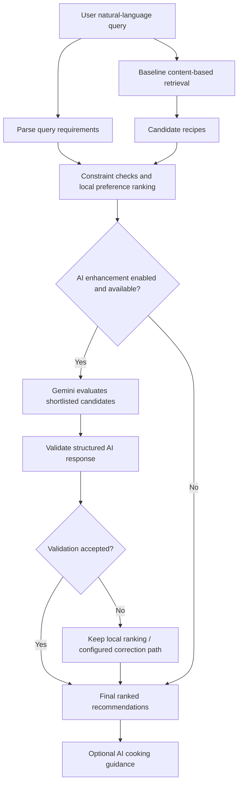

# SmartRecipe AI 🍲

AI-assisted recipe discovery using content-based retrieval, ingredient embeddings, constraint-aware ranking, and optional Gemini-based reranking and cooking guidance.

> **Project status:** Academic / portfolio project. Recommendation quality depends on the recipe dataset, preprocessing, and relevance judgments. AI-generated scores and cooking suggestions are not ground-truth measurements or verified nutrition advice.

## Table of contents

- [Overview](#overview)
- [How it works](#how-it-works)
- [Features](#features)
- [Technology stack](#technology-stack)
- [Project structure](#project-structure)
- [Requirements](#requirements)
- [Local setup](#local-setup)
- [Configure Gemini](#configure-gemini)
- [Run the application](#run-the-application)
- [Run the AI pipeline demo](#run-the-ai-pipeline-demo)
- [Modelling and evaluation](#modelling-and-evaluation)
- [Deployment: important Vercel note](#deployment-important-vercel-note)
- [Environment variables](#environment-variables)
- [Privacy, safety, and limitations](#privacy-safety-and-limitations)
- [Roadmap](#roadmap)
- [Acknowledgements](#acknowledgements)

## Overview

SmartRecipe AI helps users discover recipes from a recipe dataset using a natural-language request such as:

- `quick vegetarian recipes with chickpeas`
- `high protein dinner with vegetables`
- `Japanese vegetarian dishes`

The project uses a **retrieval-first hybrid architecture**. A conventional content-based model retrieves candidate recipes. The backend then applies locally implemented requirements and preference logic. When enabled and available, Google Gemini evaluates the retrieved candidates and can produce additional cooking guidance.

The AI layer is intended to **rerank existing candidate recipes, not invent the recommendation list from scratch**. The local ranking remains useful if the external AI request fails.

## How it works



### Baseline modelling

The modelling notebook prepares recipe representations from text and ingredient data:

1. Explore and inspect the dataset.
2. Sample the dataset for experimentation (`frac=0.25`, `random_state=42` in the described notebook).
3. Normalise and tokenize text; remove stopwords and apply Porter stemming.
4. Train Word2Vec on ingredient tokens.
5. Build TF-IDF features from recipe `name`, `tags`, and `description` (`min_df=5`).
6. Average ingredient word vectors to create a fixed-size ingredient representation.
7. Concatenate the TF-IDF and ingredient representations.
8. Save prepared artefacts for retrieval.
9. Compare a query representation against recipe representations using cosine similarity and return the nearest candidates.

The baseline is content-based: it uses recipe attributes rather than requiring a user's rating history.

### AI enhancement

When configured and available, the backend can:

1. Parse the user's requirements into structured fields.
2. Retrieve baseline candidates.
3. Apply deterministic constraint checks and local preference ranking.
4. Send the shortlist to Gemini for structured candidate evaluation.
5. Validate the response against available candidates and constraints.
6. Use the accepted ranking, or fall back to the local ranking if AI fails or its response is rejected.
7. Optionally generate additional descriptions, cooking-step suggestions, and practical tips.

AI-generated scores are model judgments; they should not be interpreted as calibrated probabilities or measured accuracy.

## Features

- Content-based recipe retrieval with TF-IDF and Word2Vec ingredient features.
- Cosine-similarity ranking of candidate recipes.
- Natural-language requirement parsing.
- Deterministic constraint checks and local preference ranking.
- Optional Gemini-based ranking of retrieved candidates.
- Structured AI response validation and a local fallback path.
- Optional AI-generated recipe descriptions and cooking suggestions.
- Trace logging for inspecting pipeline stages and errors.
- Experiment and evaluation support where the corresponding scripts and labelled data are available.

## Technology stack

- **Language:** Python
- **Data and modelling:** Pandas, NumPy, scikit-learn, NLTK, Gensim / Word2Vec
- **Similarity:** cosine similarity
- **Application:** Streamlit
- **Generative AI:** Google Gemini via the Google GenAI Python SDK
- **Configuration:** environment variables / `.env`
- **Artifacts:** serialized local model files (pickle)

Exact dependencies and paths should be checked against the current project files and dependency manifest.

## Project structure

The following is a guide to the key files discussed in this project. Some additional files may exist in your repository.

```text
RecipeRecommendation_Project/
├── EDA.ipynb
├── modelling.ipynb
├── advanced_modelling.ipynb
├── streamlit_app.py
├── ai_enhancement_demo.py
├── backend/
│   ├── config.py
│   ├── pipeline.py
│   ├── input_processor.py
│   ├── baseline_service.py
│   ├── preference_ranker.py
│   ├── ai_ranker.py
│   ├── llm_provider.py
│   ├── constraint_validator.py
│   └── schemas.py
├── input/
│   └── [required dataset and model artifacts]
├── logs/
│   └── pipeline_trace.jsonl
├── .env.example
├── .gitignore
└── requirements.txt
```

- `EDA.ipynb` — explores dataset structure and patterns.
- `modelling.ipynb` — builds the TF-IDF + Word2Vec content-based retrieval representation.
- `advanced_modelling.ipynb` — separate collaborative-filtering experiment, if included in the deployed version.
- `streamlit_app.py` — Streamlit user interface.
- `ai_enhancement_demo.py` — command-line walkthrough of the backend pipeline.
- `backend/pipeline.py` — coordinates the request, retrieval, ranking, AI enhancement, validation, and trace output.
- `backend/llm_provider.py` — connects to the configured Gemini model.
- `logs/pipeline_trace.jsonl` — runtime trace output; do not commit sensitive user queries or secrets.

## Requirements

- Python 3.10 (the project has been tested in a Python 3.10 environment).
- The project dataset and all required model artifacts.
- Internet access for live Gemini API requests.
- A Gemini API key if AI enhancement is enabled.

## Local setup

Run commands from the project root—the directory containing `streamlit_app.py`.

### 1. Clone the repository

```bash
git clone https://github.com/YOUR-USERNAME/smartrecipe-ai.git
cd smartrecipe-ai
```

Replace `YOUR-USERNAME` with your GitHub username and adjust the folder name if needed.

### 2. Create and activate a virtual environment

**Windows PowerShell**

```powershell
py -3.10 -m venv .venv
.\.venv\Scripts\Activate.ps1
```

**macOS / Linux**

```bash
python3.10 -m venv .venv
source .venv/bin/activate
```

### 3. Install dependencies

```bash
python -m pip install --upgrade pip
pip install -r requirements.txt
```

If the repository does not contain a complete `requirements.txt`, create or update it from the tested environment before expecting a fresh install to work.

### 4. Prepare the data and model artifacts

Ensure the dataset and serialized artifacts required by the baseline service exist at the paths expected by `backend/config.py` and `backend/baseline_service.py`. Do not assume that a `.pkl` artifact is present merely because the notebook can create it.

### 5. Configure environment variables

Copy `.env.example` to `.env` and add your own key locally. Never commit `.env`.

### 6. Launch Streamlit

```bash
python -m streamlit run streamlit_app.py
```

Streamlit prints a local URL in the terminal. Open that URL in your browser.

## Configure Gemini

Create a `.env` file in the project root, using the variable names expected by `backend/config.py`. For example:

```dotenv
GEMINI_API_KEY=replace_with_your_own_key
GEMINI_MODEL=gemini-2.5-flash
LLM_PROVIDER=gemini
AI_CACHE_ENABLED=true
```

These are example values. Check `backend/config.py` for the authoritative names and defaults in your checkout. Keep the actual key private and out of source control.

If Gemini returns a quota, authentication, or network error, the AI stage may not complete. Inspect the terminal and `logs/pipeline_trace.jsonl`; do not describe a fallback-only run as a successful live AI-enhanced run.

## Run the AI pipeline demo

From the project root:

```bash
python ai_enhancement_demo.py
```

Or provide a query:

```bash
python ai_enhancement_demo.py "quick vegetarian recipes with chickpeas"
```

The demo is intended to show intermediate pipeline results such as parsed requirements, baseline candidates, locally ranked candidates, AI ranking and validation, enrichment, metadata, and errors where those fields are returned by the current implementation.

## Modelling and evaluation

### Modelling concepts

- **TF-IDF:** weights terms according to their frequency in a recipe and across the document collection.
- **Word2Vec:** learns ingredient-token vectors from the ingredient text in the dataset.
- **Combined representation:** concatenates the TF-IDF representation with the averaged ingredient representation.
- **Cosine similarity:** ranks candidates by vector alignment.
- **AI reranking:** evaluates a retrieved shortlist; it does not replace the baseline retrieval step.

### Evaluation

Evaluate the baseline and AI-enhanced versions on the same fixed test queries and using the same independent relevance judgments.

Useful ranking metrics include:

- **Precision@K:** fraction of the top K results judged relevant.
- **Recall@K:** fraction of the judged relevant items that appear in the top K; this needs an adequately judged pool beyond only the returned top K.
- **MRR@K:** rewards placing the first relevant result higher.
- **NDCG@K:** evaluates ranking order and can support graded relevance labels.

Accuracy, precision, recall, and F1 require a clearly defined relevant/irrelevant classification rule and labelled examples. Do not calculate or report these metrics from the recommender's own predictions as if those predictions were ground truth. AI-generated scores are not ground-truth labels.

If reporting previously obtained metrics, identify the test set size and relevance-judgment method, and make clear whether the figures are baseline or AI-enhanced results.

## Deployment: important Vercel note

**The current user interface is Streamlit. Vercel is not a straightforward, native deployment target for a conventional Streamlit server**, because Streamlit relies on a persistent Python process and WebSocket-based sessions. Vercel's Python functions are serverless functions and are not a drop-in host for a long-running Streamlit server.

Recommended paths:

### Option A — Deploy the existing Streamlit application

Deploy the project to a hosting service that supports long-running Streamlit/Python applications. Configure the required environment variables and ensure the dataset and model artifacts are available at runtime. This is the least disruptive option for the current codebase.

### Option B — Use Vercel for a web frontend

If Vercel is a requirement, use it for a separate frontend (for example, a Next.js application) and expose the Python recommendation pipeline through a separately hosted API service. The API service must load the model artifacts and securely store the Gemini key. The Vercel frontend calls the API over HTTPS.

```text
Browser
   |
   v
Vercel frontend (Next.js / React)
   |
   | HTTPS API request
   v
Hosted Python API (FastAPI or equivalent)
   |
   +--> Baseline retrieval and local ranking
   |
   +--> Gemini enhancement
   |
   +--> Recipe/model artifacts
```

This second architecture requires additional API endpoints, CORS configuration, deployment settings, and a decision about how to host the model artifacts. It is not achieved by simply importing `streamlit_app.py` into Vercel.

### Deployment checklist

- [ ] Decide whether to keep Streamlit or build a separate Vercel frontend.
- [ ] Check the repository's actual file structure and dependency manifest.
- [ ] Store `GEMINI_API_KEY` in the hosting provider's environment settings; never expose it to browser code.
- [ ] Ensure model artifacts and datasets are available to the deployed backend.
- [ ] Test cold starts, memory use, request timeouts, and API quota errors.
- [ ] Add appropriate error handling and avoid returning secret values in logs.
- [ ] Verify that the deployed app returns real recommendations and that AI status is clearly shown.

## Environment variables

| Variable | Purpose |
|---|---|
| `GEMINI_API_KEY` | Secret key for Gemini requests |
| `GEMINI_MODEL` | Gemini model name |
| `LLM_PROVIDER` | Configured LLM provider |
| `AI_CACHE_ENABLED` | Enables/disables AI result caching, if supported by the current code |

Check `backend/config.py` for the complete and authoritative configuration schema. Set secrets in the deployment platform's environment settings rather than in frontend code or committed files.

## Privacy, safety, and limitations

- Do not commit API keys, private environment files, or sensitive runtime logs.
- Treat AI ranking scores as generated judgments, not calibrated probabilities.
- AI-generated cooking steps and tips may contain mistakes; verify them before relying on them.
- Ingredient matching depends on dataset completeness and implemented matching rules. Do not treat the app as a certified allergy checker or medical nutrition system.
- Be transparent when Gemini fails and local fallback results are displayed.
- Document dataset provenance, licensing, and any personal or sensitive data before public release.
- Only claim improvements over the baseline when supported by a fair evaluation on fixed queries and independent labels.

## Roadmap

- [ ] Add a repeatable evaluation dataset with human relevance judgments.
- [ ] Compare baseline and AI-enhanced ranking on identical queries.
- [ ] Report Precision@K, MRR@K, and NDCG@K with evaluation details.
- [ ] Improve explicit required-ingredient checks and document their limitations.
- [ ] Track latency, cache hits, and API calls without logging secrets.
- [ ] Add automated tests for constraint violations, malformed AI output, and fallback behaviour.
- [ ] If using Vercel, separate the frontend from the Python recommendation API.

## Acknowledgements

Built as an AI/ML recipe recommendation project exploring content-based retrieval, hybrid representations, constraint-aware ranking, and generative AI assistance.

---

**Maintainer:** YOUR NAME  
**Repository:** `smartrecipe-ai`
