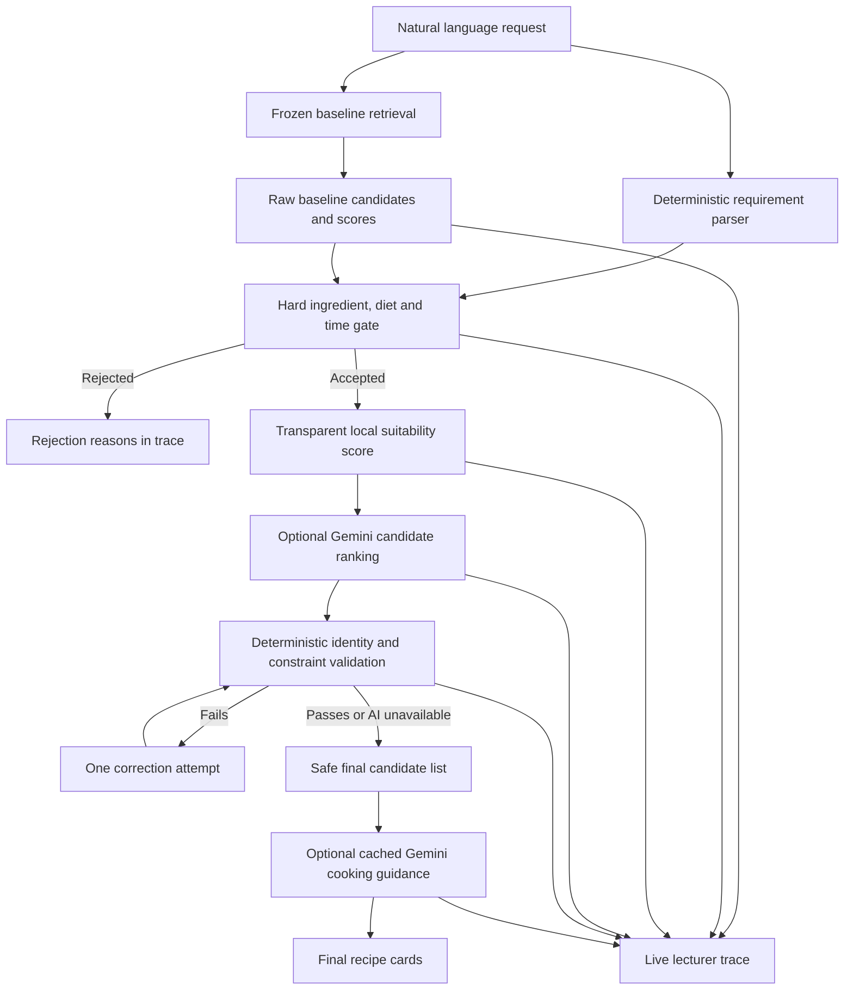

# SmartRecipe AI architecture

## Design principle

The original TastyFinds retrieval implementation and serialized artifacts are protected baseline components. SmartRecipe AI wraps that baseline with input interpretation, constraint validation, transparent scoring, optional AI ranking, and optional AI recipe-card enrichment. The AI model cannot invent a recipe or replace the source ingredient, cooking time, rating, or nutrition fields.

## Component boundaries

| Component | Responsibility | Protected or new |
|---|---|---|
| `app_reciperecs.py` and saved pickle artifacts | Original recommender and its data/model provenance | Existing baseline retained |
| `backend/baseline_service.py` | Calls the original TF-IDF and cosine-similarity workflow and exposes candidate metadata | Wrapper around baseline |
| `backend/input_processor.py` | Extracts common ingredients, time limits, diet, servings, meal and cuisine terms | New deterministic parser |
| `backend/preference_ranker.py` | Hard gates, weighted local score, score breakdown and reasons | New enhancement |
| `backend/ai_ranker.py` | Gemini ranking and enrichment orchestration with local caching | New enhancement |
| `backend/constraint_validator.py` | Checks selected recipe identity and explicit constraints against source data | New validation |
| `backend/pipeline.py` | Backend orchestration contract `run_pipeline(query)`; owns retrieval, filtering, scoring, AI, validation, logging and metadata | New backend service interface |
| `streamlit_app.py` | Presentation layer; calls `run_pipeline(query)` and renders returned stages without reimplementing ranking logic | New interface around baseline |
| `run_experiments.py` | Replays same test requests across A/B/C/D variants and records actual metrics | New evaluation tooling |

## Safety invariants

1. A recipe shown as a final recommendation must pass the final deterministic hard-constraint gate.
2. Required ingredients are verified against the dataset ingredient list only. Titles, tags, and AI prose cannot satisfy the ingredient requirement.
3. AI can only refer to candidate IDs supplied by the baseline and cannot change source facts.
4. If no eligible candidate is retrieved, the application reports no valid match rather than inventing one.
5. API failures do not become fabricated AI success. The trace records that the AI stage failed or was skipped.
6. API keys are loaded from `.env`, redacted from errors, and never written to experiment logs.
